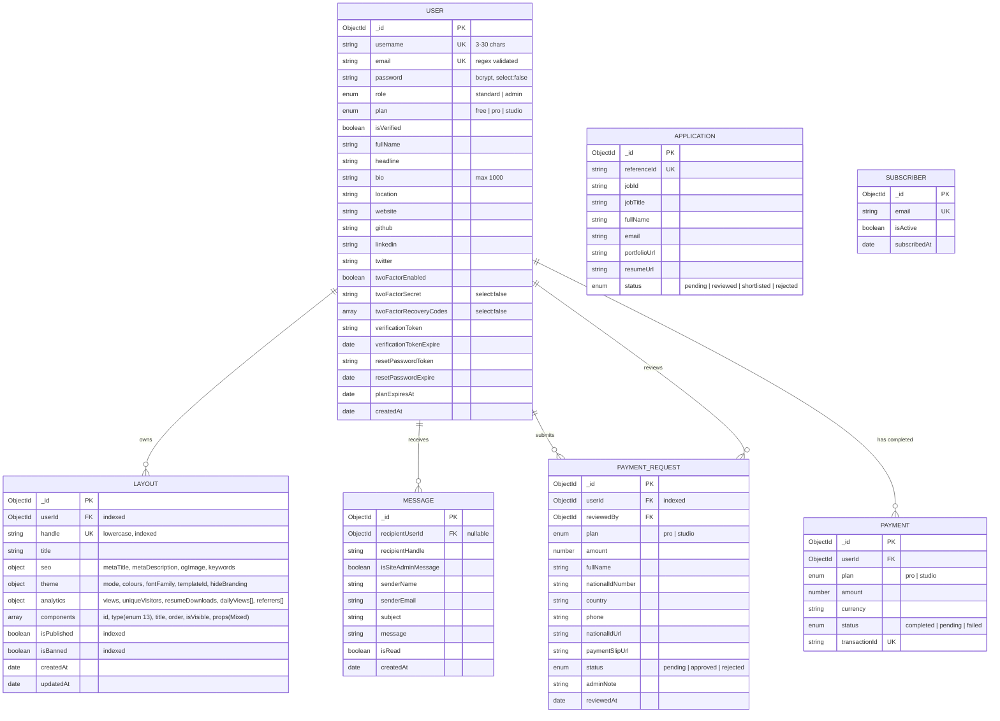
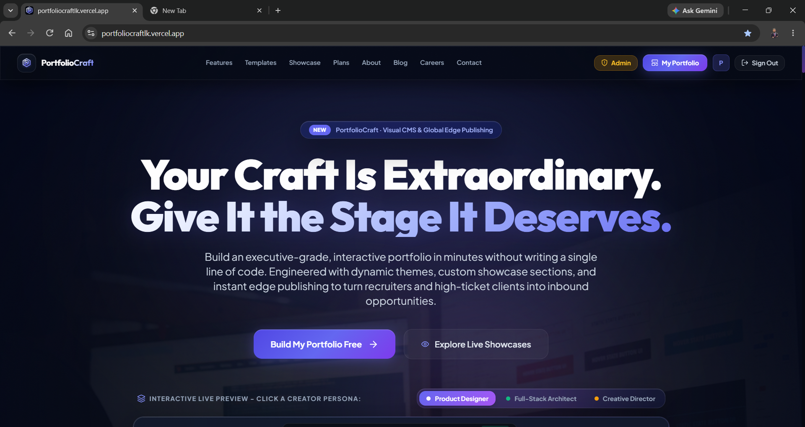
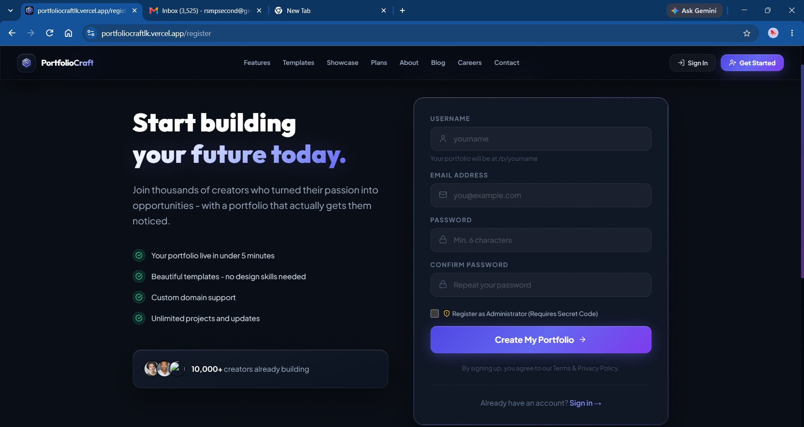
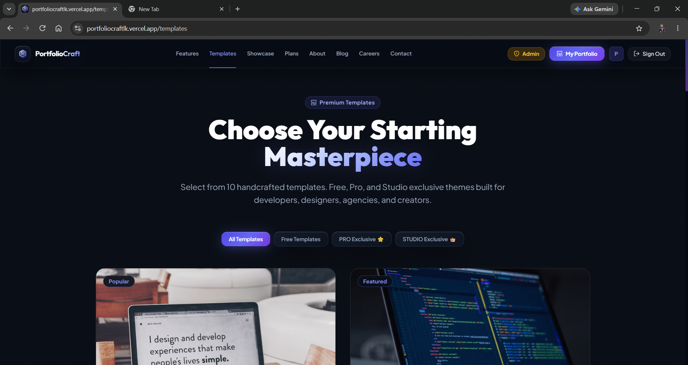
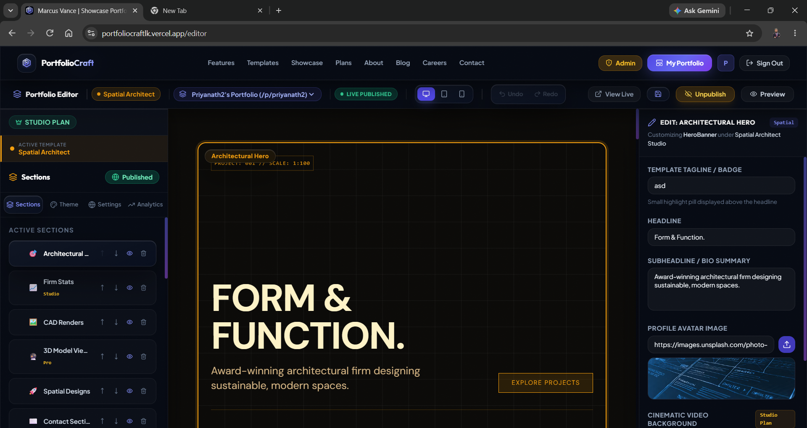
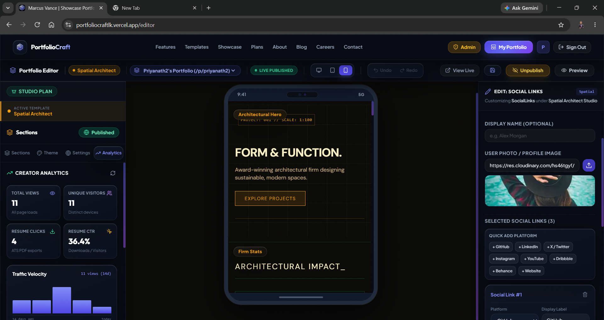
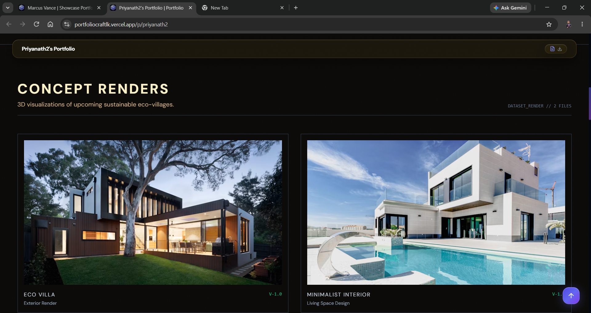
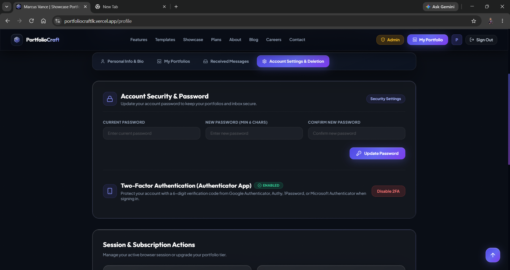
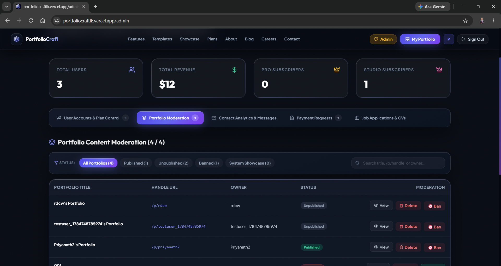
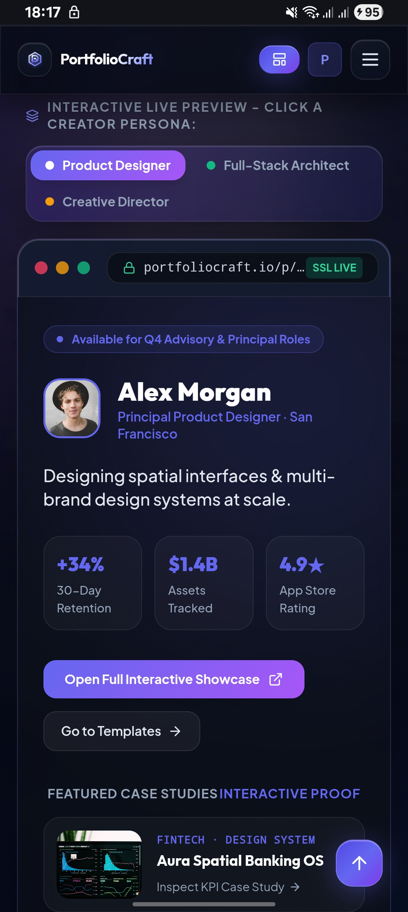

# PortfolioCraft: Portfolio Management Platform

A full-stack **MERN** web application where users build, theme, publish and track their own portfolio websites using a visual, section-based CMS editor. Every portfolio is stored as flexible JSON in MongoDB and served on a public URL (`/p/<handle>`).

> **EE4207 Web Application Development: Mini Project**
> Author: Priyanath R.S.M.
> Faculty of Engineering, University of Ruhuna

| | |
|---|---|
| **Live deployment** | [https://portfoliocraftlk.vercel.app](https://portfoliocraftlk.vercel.app) |
| **Sample Published Portfolio** | [https://portfoliocraftlk.vercel.app/p/lucia](https://portfoliocraftlk.vercel.app/p/lucia) |
| **Demo video** | [Google Drive Link](https://drive.google.com/drive/folders/1ZCyJ2a7vWsZ2wUb7fakrdUYzLm9xqYc?usp=drive_link) |

---

## Table of Contents

1. [Overview](#1-overview)
2. [Features](#2-features)
3. [Tech Stack](#3-tech-stack)
4. [System Architecture](#4-system-architecture)
5. [Database Design (ERD)](#5-database-design-erd)
6. [CRUD Coverage](#6-crud-coverage)
7. [REST API Reference](#7-rest-api-reference)
8. [Frontend Routes](#8-frontend-routes)
9. [Security](#9-security)
10. [Repository Structure](#10-repository-structure)
11. [Getting Started](#11-getting-started)
12. [Environment Variables](#12-environment-variables)
13. [Deployment and CI/CD](#13-deployment-and-cicd)
14. [Screenshots](#14-screenshots)
15. [Known Limitations](#15-known-limitations)
16. [Criteria Mapping](#16-rubric-mapping)
17. [Further Documentation](#17-further-documentation)

---

## 1. Overview

PortfolioCraft lets creators (developers, designers, photographers) assemble a portfolio from reusable **section components** (hero, about, projects, timeline, skills and more) without writing code. Users pick a template, edit content live, customise the theme, preview on desktop/tablet/mobile viewports, publish to a unique handle, and watch visitor analytics. Administrators moderate users, portfolios, payments, messages and job applications from a dedicated dashboard.

**Main entity for CRUD:** `Layout` (a portfolio), supported by `User`, `Message`, `Application`, `PaymentRequest` and `Subscriber`.

---

## 2. Features

### Authentication and account management
- Registration with email verification (SHA-256 hashed, 24-hour token)
- Login with JWT (Passport-JWT, Bearer token, 30-day default expiry)
- Forgot/reset password via emailed token (10-minute expiry)
- **Two-factor authentication (TOTP):** in-house RFC 6238 implementation, QR-code setup for authenticator apps, backup recovery codes, enable/disable flow
- Profile editing (name, headline, bio, location, website, GitHub, LinkedIn, Twitter) and password change
- Self-service account deletion (password-confirmed, cascades to the user's portfolios and messages)
- Role-based access: `standard` and `admin`

### Visual portfolio editor (CMS)
- **13 section types:** `HeroBanner`, `AboutMe`, `ProjectsGrid`, `ExperienceTimeline`, `SkillsCloud`, `ContactSection`, `MediaGallery`, `TestimonialsCarousel`, `PremiumEmbed`, `AdvancedMetrics`, `RichTextSection`, `SocialLinks`, `CustomHTML`
- Add, edit, reorder, show/hide and delete sections; live inspector panel with instant canvas update
- **Undo / Redo** (Ctrl+Z / Ctrl+Y) backed by a Redux history stack
- **5 starter templates:** Minimalist Editorial, Dark Cyber, Creative Director, Interactive Showcase, Luxury Motion Pro
- Theme customiser: colour palettes, custom colour tokens, font family, dark/light/custom mode, optional branding removal
- **Responsive viewport simulator:** desktop, tablet (768px) and mobile (390px) preview without leaving the editor
- Per-portfolio SEO settings (meta title/description, OG image, keywords)
- Media upload (images and video, up to 50 MB) to Cloudinary

### Publishing and analytics
- Unique, lowercase **handle URL** per portfolio (`/p/<handle>`), explicit publish toggle
- Multiple portfolios per user depending on plan (Free 1 · Pro 3 · Studio 5)
- Creator analytics: total views, unique visitors, daily series, referrer breakdown (LinkedIn, GitHub, Twitter/X, Google, social, direct) and resume downloads
- **ATS-friendly resume generator**: extracts structured data from the portfolio and produces a printable resume
- Dynamic `sitemap.xml` (includes all published, non-banned portfolios) and `robots.txt`

### Public site and communication
- Marketing pages: Home, Features, Templates (with live preview), Showcase, Pricing, About, Blog, Careers, Contact, plus Terms, Privacy, Cookie and Security pages
- Visitor contact form on every portfolio, delivered to the portfolio owner's inbox in the dashboard
- Newsletter subscription with welcome email
- Careers page with job application submission (unique reference ID per application)

### Plans and payments
- Free / Pro ($12) / Studio ($29) plans
- **Manual payment workflow:** user submits personal details, national ID and payment slip (uploaded to Cloudinary) → admin approves or rejects with a note → plan is upgraded and the user is emailed

### Admin dashboard
- System statistics (users, portfolios, payments, subscribers, messages)
- User management: list, warn by email, change plan, delete (admin password required)
- Portfolio moderation: publish/unpublish, ban/unban (owner is emailed the reason), delete
- Payment request review (approve / reject)
- Job application review (status: pending → reviewed → shortlisted / rejected) and deletion
- Site-level contact message inbox

### Quality and UX
- Fully responsive layout (Tailwind CSS), mobile slide-over panels in the editor
- Route-level code splitting (heavy pages lazy-loaded) and manual vendor chunks
- Framer Motion animations, consistent dark "cyber" theme
- Branded HTML email templates

---

## 3. Tech Stack

| Layer | Technology |
|---|---|
| **Frontend** | React 18, Vite 5, React Router 6, Redux Toolkit, Axios, Tailwind CSS 3, Framer Motion, Lucide React |
| **Backend** | Node.js (≥ 18), Express 4 |
| **Database** | MongoDB (Atlas recommended) via Mongoose 7 |
| **Auth** | Passport-JWT, jsonwebtoken, bcryptjs, custom TOTP (2FA) |
| **Media** | Cloudinary, Multer, multer-storage-cloudinary |
| **Email** | Nodemailer (Gmail SMTP) with SendGrid fallback |
| **Security** | Helmet, CORS, express-rate-limit |
| **Logging** | Morgan, Winston (installed) |
| **DevOps** | GitHub Actions, Render (API), Vercel / Render static (frontend) |

---

## 4. System Architecture

```
┌──────────────────────┐   HTTPS /api/*    ┌────────────────────────┐
│  React SPA (Vite)    │ ────────────────► │  Express REST API      │
│  Redux Toolkit store │ ◄──────────────── │  Passport-JWT, Helmet, │
│  Axios + JWT header  │       JSON        │  rate limiting         │
└──────────────────────┘                   └──────┬─────────┬───────┘
                                                  │         │
                                     Mongoose ODM │         │ Multer / SDK
                                                  ▼         ▼
                                        ┌──────────────┐  ┌──────────────┐
                                        │ MongoDB Atlas│  │  Cloudinary  │
                                        └──────────────┘  └──────────────┘
                                                  │
                                      Nodemailer / SendGrid  → verification, reset,
                                                               moderation & plan emails
```

- **Frontend state:** `authSlice` (session, login, 2FA, admin elevation) and `layoutSlice` (current layout, portfolio list, templates, undo/redo history).
- **API client:** a single Axios instance (`baseURL: /api`) attaches the JWT from `localStorage`. In development, Vite proxies `/api` to `http://localhost:5000`; in production, `frontend/vercel.json` rewrites `/api` to the Render backend.
- **Rendering:** `ComponentRenderer` maps each stored component `type` to a React section component, so the editor canvas and public page share the same renderer.
- **Layout storage:** a layout holds an ordered `components[]` array where each item has `id`, `type`, `order`, `isVisible` and a schema-less `props` object, giving every portfolio an independent structure.

---

## 5. Database Design (ERD)

MongoDB with Mongoose schemas, validation and indexes.



**Design notes**
- **Keys and uniqueness:** `User.username`, `User.email`, `Layout.handle`, `Application.referenceId`, `Payment.transactionId` and `Subscriber.email` are unique.
- **Indexes:** `Layout` has compound indexes on `{handle, isPublished, isBanned}` and `{userId, updatedAt}`; `PaymentRequest` on `{status, createdAt}`.
- **Why a document DB:** portfolio structure varies per user, so components are embedded as a flexible array instead of being split across many relational tables.
- **Referential cleanup:** deleting a user (by self or admin) also deletes their layouts and received messages.
- Sensitive fields (`password`, 2FA secrets and recovery codes) use `select: false`.

---

## 6. CRUD Coverage

| Entity | Create | Read | Update | Delete |
|---|---|---|---|---|
| **Layout (portfolio)** | `POST /api/layouts/new` (plan-limited, unique handle) | `GET /api/layouts/my-portfolios`, `GET /api/layouts/me?id=`, public `GET /api/layouts/public/:handle` | `PUT /api/layouts/me` (components, theme, SEO), publish toggle | `DELETE /api/layouts/id/:layoutId` |
| **Component (section)** | `POST /api/layouts/component` | Rendered from layout | `POST /api/layouts/component` (upsert), reorder/visibility via layout update | `DELETE /api/layouts/component/:componentId` |
| **User** | `POST /api/auth/register` | `GET /api/auth/me`, admin `GET /api/admin/users` | `PUT /api/auth/profile`, `PUT /api/auth/password`, admin plan change | `POST /api/auth/delete-account`, admin `DELETE /api/admin/user/:id` |
| **Message** | `POST /api/messages` (public contact form) | `GET /api/messages/me`, `GET /api/messages/admin` | `GET /api/messages/:id/read` (mark read) | `DELETE /api/messages/:id` |
| **Application** | `POST /api/careers/apply` | `GET /api/careers/admin` | `PUT /api/careers/admin/:id/status` | `DELETE /api/careers/admin/:id` |
| **PaymentRequest** | `POST /api/payment/submit` | `GET /api/payment/my-requests`, admin list | admin approve / reject | n/a (retained as an audit trail) |
| **Subscriber** | `POST /api/newsletter/subscribe` | `GET /api/newsletter/count` | n/a | n/a |

**Search, filter, sort:** the Templates page filters by category, the Showcase lists public portfolios, and the admin dashboard lists and filters users, portfolios, payments, applications and messages.

---

## 7. REST API Reference

Base path: `/api`. 🔒 = JWT required · 🛡️ = admin only. Global limit: 100 requests / 15 min / IP.

<details>
<summary><strong>Auth</strong> (<code>/api/auth</code>)</summary>

| Method | Endpoint | Access | Description |
|---|---|---|---|
| POST | `/register` | Public (rate-limited) | Register and send verification email |
| GET | `/verify-email/:verificationToken` | Public | Verify email |
| POST | `/login` | Public (rate-limited) | Login, returns JWT or a 2FA challenge |
| POST | `/2fa/login-verify` | Public (temp token) | Complete login with TOTP or recovery code |
| POST | `/forgot-password` | Public (rate-limited) | Email reset link |
| POST | `/reset-password/:token` | Public | Set a new password |
| GET | `/me` | 🔒 | Current user |
| POST | `/resend-verification` | 🔒 | Resend verification email |
| POST | `/elevate-admin` | 🔒 | Elevate to admin with secret code |
| PUT | `/profile` | 🔒 | Update profile |
| PUT | `/password` | 🔒 | Change password |
| POST | `/2fa/setup` · `/2fa/verify-setup` · `/2fa/disable` | 🔒 | Manage 2FA |
| POST | `/delete-account` | 🔒 | Delete own account |
</details>

<details>
<summary><strong>Layouts</strong> (<code>/api/layouts</code>)</summary>

| Method | Endpoint | Access | Description |
|---|---|---|---|
| GET | `/public/:handle` | Public | Published portfolio; records view and referrer |
| POST | `/track-download/:handle` | Public | Record a resume download |
| GET | `/my-portfolios` | 🔒 | List own portfolios and plan limit |
| POST | `/new` | 🔒 | Create portfolio |
| GET | `/me` | 🔒 | Load a portfolio for editing (`?id=`) |
| PUT | `/me` | 🔒 | Save components, theme, SEO, publish state |
| POST | `/component` | 🔒 | Add or update one component |
| DELETE | `/component/:componentId` | 🔒 | Remove one component |
| DELETE | `/id/:layoutId` | 🔒 | Delete a portfolio |
| GET | `/analytics/:id` | 🔒 | Analytics for one portfolio |
| GET | `/admin/all` | 🛡️ | All layouts |
</details>

<details>
<summary><strong>Admin</strong> (<code>/api/admin</code>), all 🛡️</summary>

| Method | Endpoint | Description |
|---|---|---|
| GET | `/stats` | System statistics |
| GET | `/users` | List users |
| PUT | `/user/:id/warn` | Email a moderation warning |
| PUT | `/user/:id/plan` | Change plan |
| DELETE | `/user/:id` | Delete user and their data |
| GET | `/layouts` | List all portfolios |
| PUT | `/layout/:id/toggle-publish` | Publish / unpublish |
| PUT | `/layout/:id/toggle-ban` | Ban / unban and notify owner |
| DELETE | `/layout/:id` | Delete portfolio |
| GET | `/payment-requests` | List payment requests |
| PUT | `/payment-request/:id/approve` · `/reject` | Review payment request |
</details>

<details>
<summary><strong>Other</strong></summary>

| Method | Endpoint | Access | Description |
|---|---|---|---|
| POST | `/api/messages` | Public | Send contact message |
| GET | `/api/messages/me` | 🔒 | Messages received by the user |
| GET / POST | `/api/messages/admin` · `/admin/unlock` | 🛡️ | Site inbox |
| GET | `/api/messages/:id/read` | 🔒 | Mark as read |
| DELETE | `/api/messages/:id` | 🔒 | Delete message |
| POST | `/api/careers/apply` | Public | Submit job application |
| GET / PUT / DELETE | `/api/careers/admin[/:id[/status]]` | 🛡️ | Review applications |
| POST | `/api/newsletter/subscribe` | Public | Subscribe |
| GET | `/api/newsletter/count` | Public | Subscriber count |
| POST | `/api/payment/submit` | 🔒 | Submit payment request (multipart) |
| GET | `/api/payment/my-requests` · `/history` | 🔒 | Payment history |
| GET | `/api/upload/signature` | 🔒 | Cloudinary upload signature |
| POST | `/api/upload` | 🔒 | Upload image/video |
| GET | `/api/health` | Public | Health check |
| GET | `/sitemap.xml` · `/robots.txt` | Public | SEO files |
</details>

---

## 8. Frontend Routes

| Area | Routes |
|---|---|
| **Public** | `/`, `/features`, `/templates`, `/preview/:templateId`, `/showcase`, `/showcase/:handle`, `/plans` (`/pricing`), `/about`, `/blog`, `/careers`, `/contact`, `/terms`, `/privacy`, `/cookies`, `/security` |
| **Auth** | `/login`, `/register`, `/forgot-password`, `/reset-password/:token`, `/verify-email/:token` |
| **Public portfolio** | `/p/:handle` (alias `/portfolio/:handle`) |
| **Private** (login and verified email required) | `/editor`, `/profile`, `/payment/:planId`, `/payment-success` |
| **Admin** | `/admin` (admin role plus secret code) |

---

## 9. Security

- Passwords hashed with **bcrypt** (10 salt rounds); minimum length enforced client- and server-side
- **JWT** bearer authentication through Passport; protected routes verify the user on every request
- **Role checks** on all admin endpoints; destructive admin actions require the admin's password
- **TOTP 2FA** with hashed-token email verification, recovery codes and a short-lived (10 min) challenge token
- **Rate limiting:** global API limiter plus stricter limits on login (10 / 15 min), registration (10 / hour), password reset (5 / 15 min) and resend verification (5 / 15 min)
- **Helmet** security headers, CORS with credentials, 10 MB JSON body limit, 50 MB upload limit with a file-format allow-list
- Mongoose schema validation (enums, lengths, regex) and uniqueness constraints
- Sensitive fields excluded from queries by default (`select: false`)
- Banned portfolios are hidden from public routes and the sitemap

---

## 10. Repository Structure

```
portfolio-platform/
├── .github/workflows/ci-cd.yml      # GitHub Actions: backend syntax check + frontend build
├── .npmrc                           # legacy-peer-deps=true
├── render.yaml                      # Render blueprint (API + static frontend)
├── vercel.json                      # Vercel monorepo build/routing
├── documentation/                   # Detailed project report sections (01-07)
│
├── backend/
│   ├── server.js                    # Express app, middleware, route mounting, sitemap/robots
│   ├── seed.js                      # Seeds a sample admin user and showcase portfolio
│   ├── .env.example                 # Environment variable template
│   ├── config/
│   │   ├── db.js                    # MongoDB connection
│   │   ├── passport.js              # JWT strategy
│   │   └── cloudinary.js            # Cloudinary + Multer storage
│   ├── models/                      # User, Layout, Message, Application,
│   │                                # PaymentRequest, Payment, Subscriber
│   ├── routes/                      # auth, layout, admin, message, career,
│   │                                # payment, upload, newsletter
│   └── utils/
│       ├── sendEmail.js             # Gmail SMTP / SendGrid delivery
│       ├── emailTemplate.js         # Branded HTML email templates
│       └── totp.js                  # RFC 6238 TOTP implementation
│
└── frontend/
    ├── index.html · vite.config.js · tailwind.config.js · vercel.json
    ├── public/                      # favicon, robots.txt, sitemap.xml
    └── src/
        ├── main.jsx · App.jsx       # Entry point, router, PrivateRoute, lazy loading
        ├── index.css                # Tailwind layers and design tokens
        ├── services/api.js          # Axios instance with JWT interceptor
        ├── store/                   # authSlice, layoutSlice, store config
        ├── data/                    # templateLayouts, demoLayouts, showcaseData
        ├── utils/                   # resumeGenerator, sampleData
        ├── components/
        │   ├── common/              # Header, Footer, LogoIcon
        │   ├── editor/              # EditorSidebar, ComponentInspector
        │   └── portfolio/           # ComponentRenderer + 13 section components
        └── pages/                   # Home, Editor, AdminDashboard, ProfileSettings,
                                     # PublicPortfolio, Templates, Pricing, Login, ...
```

---

## 11. Getting Started

### Prerequisites

| Tool | Version |
|---|---|
| Node.js | 18+ (20 LTS recommended) |
| npm | 9+ |
| MongoDB | Atlas cluster or local 6.0+ |
| Cloudinary account | For uploads (free tier is fine) |
| Gmail app password **or** SendGrid key | For emails (optional in local dev) |

### 1. Clone

```bash
git clone <YOUR_REPO_URL>
cd portfolio-platform
```

### 2. Backend

```bash
cd backend
npm install
cp .env.example .env      # then fill in the values (see section 12)
npm run dev               # nodemon, http://localhost:5000
```

Verify with `http://localhost:5000/api/health`.

**Optional: seed sample data** (creates an admin account and a showcase portfolio):

```bash
node seed.js
```

| Seeded account | Value |
|---|---|
| Email | `admin@portfolioplatform.dev` |
| Password | `Password123!` |
| Portfolio | `/p/admin_1` |

> Change or delete this account before any public deployment.

### 3. Frontend

```bash
cd frontend
npm install
npm run dev               # http://localhost:5173 (proxies /api to :5000)
```

### 4. Production build

```bash
cd frontend
npm run build             # output in frontend/dist
npm run preview
```

### 5. Typical walkthrough

1. Register → verify email (or use the seeded admin).
2. Open **Templates**, pick one, then **Editor**.
3. Add/edit/reorder sections, change the theme, switch viewport sizes, try Undo/Redo.
4. Save and **Publish**, then open `/p/<handle>`.
5. Open the **Admin** dashboard to moderate users, portfolios and payment requests.

---

## 12. Environment Variables

### Backend (`backend/.env`)

| Variable | Required | Purpose |
|---|---|---|
| `MONGODB_URI` | ✅ | MongoDB connection string |
| `JWT_SECRET` | ✅ | JWT signing key (use a long random value) |
| `JWT_EXPIRE` | | Token lifetime (default `30d`) |
| `PORT` | | API port (default `5000`) |
| `NODE_ENV` | | `development` / `production` |
| `CLIENT_URL` | ✅ in prod | Frontend origin (CORS, sitemap, email links) |
| `CLOUDINARY_CLOUD_NAME` · `CLOUDINARY_API_KEY` · `CLOUDINARY_API_SECRET` | ✅ for uploads | Media storage |
| `GMAIL_USER` · `GMAIL_APP_PASSWORD` | One email option | Gmail SMTP sending |
| `SENDGRID_API_KEY` | One email option | SendGrid fallback |
| `ADMIN_SECRET_CODE` | ✅ in prod | Secret used to register or elevate an admin account |

### Frontend

No variables required: the API base is the relative path `/api` (Vite proxy in development, host rewrite in production).

> ⚠️ **Never commit `.env`.** `.gitignore` already excludes it.

---

## 13. Deployment and CI/CD

| Part | Platform | Notes |
|---|---|---|
| Backend API | **Render** (web service) | Defined in `render.yaml`; build `cd backend && npm install`, start `cd backend && npm start`; set secrets in the dashboard |
| Frontend | **Vercel** or Render static | `frontend/vercel.json` rewrites `/api/*` to the Render backend and all other paths to `index.html` (SPA routing) |
| Database | **MongoDB Atlas** | Allow the host's IPs in Network Access |
| Media | **Cloudinary** | CDN-delivered assets |

**GitHub Actions** (`.github/workflows/ci-cd.yml`) runs on every push/PR to `main`:
1. **Backend CI:** Node 18, `npm install`, syntax check of server, routes, models, config and utils
2. **Frontend CI:** Node 18, `npm install`, `npm run build`

---

## 14. Screenshots

> Screenshots : `documentation/screenshots/`

| Screen | Image |
|---|---|
| Home page |  |
| Login / Register |  |
| Template gallery |  |
| Editor (desktop) |  |
| Editor (mobile viewport) |  |
| Public portfolio |  |
| Profile and 2FA |  |
| Admin dashboard |  |
| Mobile view |  |

---

## 15. Known Limitations

- No custom domains; portfolios are served at `/p/<handle>`.
- Payments use a manual slip-and-approval workflow rather than an online gateway.
- No automated test suite yet; CI covers syntax and build checks only.
- Undo/Redo history is held in memory for the current editing session.
- Drag-and-drop is not used; sections are reordered with controls in the editor.

---

## 16. Criteria Mapping

| Criteria | Where it is demonstrated |
|---|---|
| **Create** | Register, new portfolio, add section, contact form, job application, payment request, newsletter |
| **Read** | Portfolio list, public portfolio page, analytics, template filtering, showcase, admin lists |
| **Update** | Editor saves, profile/password edit, theme and SEO, publish toggle, admin plan/status changes |
| **Delete** | Delete section/portfolio/message/application, self and admin account deletion with password confirmation |
| **Validation and error handling** | Mongoose validators, server-side checks and status codes, form validation, rate limiting, global 404/error handlers |
| **Database design** | Section 5: 7 collections, references, unique keys, compound indexes, enums |
| **UI/UX and responsiveness** | Tailwind responsive layouts, mobile editor panels, viewport simulator, consistent theme |
| **Code quality and structure** | Section 10: separated config/models/routes/utils, Redux slices, reusable section components, Git and CI |
| **Documentation** | This README, ERD, setup steps, screenshots, `documentation/` folder |
| **Demonstration** | See `<drive link>` |

---

## 17. Further Documentation

Detailed write-ups live in [`documentation/`](documentation/):

| File | Topic |
|---|---|
| `01_SYSTEM_OVERVIEW_AND_FEATURES.md` | Scope and feature catalogue |
| `02_CRUD_FUNCTIONALITIES_AND_OPERATIONS.md` | CRUD flows |
| `03_TECH_STACK_AND_ARCHITECTURE.md` | Technology and architecture |
| `04_DATABASE_DESIGN_AND_ERD.md` | Schema and ERD |
| `05_BUILD_INSTALLATION_AND_DEPLOYMENT.md` | Build, install, deploy |
| `06_UI_UX_AND_RESPONSIVENESS.md` | Design system and responsiveness |
| `07_DEMONSTRATION_AND_EVALUATION_GUIDE.md` | Demo script and evaluation guide |

---
