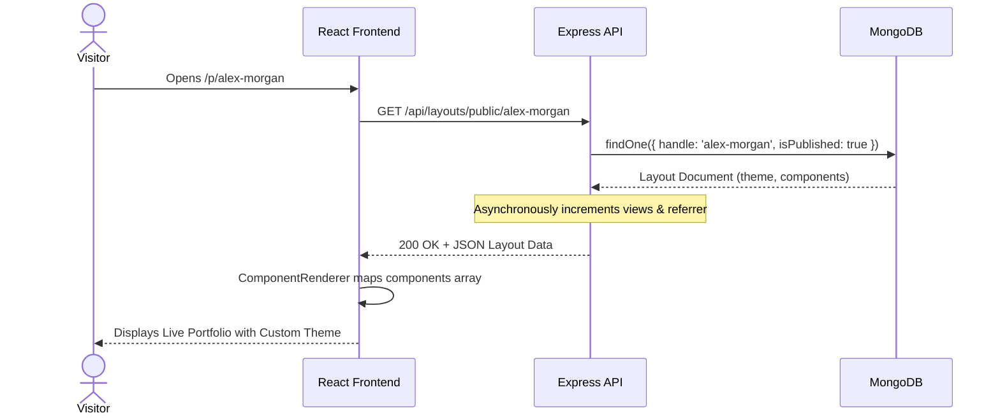

# Technical Stack & Software Architecture

**Course:** EC4307 Web Application Development Mini Project  
**Author:** Ranaweerage Shashika Madhusankha Priyanath  
**Application Title:** PortfolioCraft  

---

## 1. Complete Technology Stack Overview

PortfolioCraft follows a clean, decoupled **MERN (MongoDB, Express.js, React.js, Node.js)** architecture:

```
┌────────────────────────────────────────────────────────────────────────┐
│                        CLIENT LAYER (Browser)                         │
│   React 18  ·  Vite Bundler  ·  Redux Toolkit  ·  Tailwind CSS        │
│   Framer Motion  ·  Lucide Icons  ·  Axios Interceptors               │
└───────────────────────────────────┬────────────────────────────────────┘
                                    │ HTTPS / RESTful API (JSON)
                                    ▼
┌────────────────────────────────────────────────────────────────────────┐
│                        API GATEWAY & MIDDLEWARE                        │
│   Node.js runtime  ·  Express.js  ·  Express-Rate-Limit (DDoS Guard)   │
│   Passport-JWT Authentication  ·  Multer File Parser                   │
└───────────────────────────────────┬────────────────────────────────────┘
                                    │
                                    ▼
┌────────────────────────────────────────────────────────────────────────┐
│                      SERVICE & CONTROLLER LAYER                        │
│   Auth Controller  ·  Layout Controller  ·  Payment Controller         │
│   Analytics Aggregator  ·  Resume Vector Engine  ·  Email Service      │
└───────────────────────────────────┬────────────────────────────────────┘
                                    │ Mongoose ODM queries & validation
                                    ▼
┌────────────────────────────────────────────────────────────────────────┐
│                          DATA PERSISTENCE                              │
│   MongoDB Database  ·  Collections (users, layouts, messages, etc.)    │
│   Cloudinary CDN (Images / Media / Slips)                              │
└────────────────────────────────────────────────────────────────────────┘
```

### 1.1. Frontend Technologies
- **React 18:** Modern functional component architecture utilizing hooks (`useState`, `useEffect`, `useCallback`, `useMemo`, `useRef`).
- **Vite 5:** Blazing fast ES-module dev server and optimized rollup production bundler.
- **Redux Toolkit (`@reduxjs/toolkit` & `react-redux`):** Centralized state management for layout mutations, component properties, undo/redo history, and authentication status.
- **React Router v6 (`react-router-dom`):** Client-side dynamic routing with nested layouts, route protection (`PrivateRoute`, `AdminRoute`), and code-splitting via `React.lazy`.
- **Tailwind CSS 3:** Utility-first styling framework combined with custom CSS glassmorphism classes (`glass`, `glass-dark`, `gradient-border`).
- **Framer Motion:** Declarative micro-animations for page transitions, modal displays, and interactive portfolio cards.
- **Lucide React:** Consistent, lightweight SVG icon system.
- **Axios:** Promise-based HTTP client equipped with request interceptors to automatically attach JWT authorization bearer tokens.

### 1.2. Backend Technologies
- **Node.js (v18+ LTS):** Event-driven, asynchronous JavaScript server runtime.
- **Express.js (v4):** Fast, minimalist web framework delivering REST API endpoints.
- **Passport.js & Passport-JWT:** Stateless authentication strategy verifying signed JWT bearer tokens on protected routes.
- **BcryptJS:** One-way password hashing algorithm configured with 10 salt rounds.
- **Express-Rate-Limit:** IP-based request rate limiting mitigating brute-force attacks on sensitive authentication routes (`/login`, `/register`, `/forgot-password`).
- **Multer & Multer-Storage-Cloudinary:** Multipart form-data handling for image and payment receipt uploads to Cloudinary CDN.
- **Nodemailer:** Transactional email transport for email verification, password reset tokens, and branded notifications.

### 1.3. Database & Storage
- **MongoDB:** NoSQL document database ideal for storing polymorphic, schema-less portfolio component configurations.
- **Mongoose ODM (v8):** Elegant MongoDB object modeling providing strict schema enforcement, default values, pre-save encryption hooks, and relationship population (`populate`).
- **Cloudinary CDN:** High-performance cloud media storage with automated WebP/AVIF compression.

---

## 2. System Architecture & Component Interactions

### 2.1. Dynamic Layout Rendering Architecture
When a visitor navigates to `/p/:handle`:
1. **Client Request:** Browser requests `/p/alex-morgan`.
2. **API Dispatch:** React component calls `GET /api/layouts/public/alex-morgan`.
3. **Database Query:** Express queries MongoDB `layouts` collection for `{ handle: 'alex-morgan', isPublished: true }`.
4. **Asynchronous Telemetry:** Server asynchronously increments view counters and detects referrer source (LinkedIn, GitHub, Google, Direct) without blocking the response.
5. **JSON Delivery:** Backend returns layout document containing theme tokens and an array of ordered component objects.
6. **Dynamic Mounting:** Frontend `ComponentRenderer.jsx` iterates over `layout.components` and dynamically mounts corresponding React components (`HeroBanner`, `ProjectsGrid`, `ExperienceTimeline`, etc.) injecting creator-defined props.



---

## 3. State Management Architecture (Redux Toolkit)

The state architecture in `frontend/src/store/` is separated into dedicated domain slices:

### 3.1. `layoutSlice.js`
- **Active State:** Holds `activeLayout` (active portfolio document), `selectedComponentId`, `userPortfolios` list, `isSaving`, `saveSuccess`, `error`.
- **30-State Undo / Redo Buffer:**
  - `past`: Array of preceding layout snapshots (capped at 30 items to optimize memory).
  - `present`: Current working layout object.
  - `future`: Array of undone snapshots available for redo.
  - Any mutating action (`addComponent`, `removeComponent`, `updateComponentProps`, `reorderComponents`, `updateTheme`) pushes a clone of `present` to `past` and clears `future`.
- **Keyboard Shortcuts:** Global event listener intercepts `Ctrl+Z` / `Cmd+Z` for undo and `Ctrl+Y` / `Cmd+Shift+Z` for redo.

### 3.2. `authSlice.js`
- Manages authenticated user state (`user`, `token`, `isAuthenticated`, `loading`, `error`).
- Stores token persistently in `localStorage.getItem('portfolio_jwt_token')`.
- Handles session elevation, profile updates, and logout resets.

---

## 4. Frontend Performance & Code Splitting Optimization

To guarantee sub-second First Contentful Paint (FCP) and smooth page navigation, PortfolioCraft implements **Option A Route-Level Code Splitting**:
- **Eagerly Loaded Modules:** High-traffic marketing and public pages (`Home`, `About`, `Blog`, `Careers`, `ContactPage`, `Features`, `Plans`, `Templates`, `Showcase`, `Terms`, `Privacy`) are imported synchronously to guarantee instant page transitions with zero loading delays.
- **Lazy Loaded Heavy Modules:** Complex application workbenches (`Editor`, `AdminDashboard`, `ProfileSettings`, `PaymentForm`) are dynamically loaded on demand via `React.lazy()` and `Suspense`.
- **Vite Manual Chunking:** Configured in `vite.config.js` to split vendor dependencies into optimized bundles:
  - `vendor-react` (React, React-DOM, React-Router)
  - `vendor-state` (Redux Toolkit, React-Redux)
  - `vendor-ui` (Framer Motion, Lucide React)
- **Bundle Size:** Main entry chunk is optimized to ~129 kB gzipped, well within Google Core Web Vitals thresholds.

---

## 5. Security & Two-Factor Authentication Engine Architecture

PortfolioCraft implements an RFC 6238 compliant Time-Based One-Time Password (TOTP) engine in `backend/utils/totp.js`.

```
                               TWO-PHASE LOGIN WORKFLOW
                               
   [User] ──(1) Email & Password──> [POST /api/users/login]
                                              │
                                 ┌────────────┴────────────┐
                         2FA Disabled             2FA Enabled
                                 │                         │
                     Issues Final Signed JWT    Issues Temporary Token
                               (200 OK)         { require2FA: true }
                                                           │
   [User] ──(2) 6-Digit TOTP Token─────────────────────────┘
        ──> [POST /api/users/login/2fa-verify]
                    │
            Validates Token
                    │
         Issues Final Signed JWT
                 (200 OK)
```

### 5.1. RFC 6238 Algorithm Implementation
1. **Zero External Dependencies:** Built entirely with Node.js built-in `crypto` module:
   - Secret Generation: `crypto.randomBytes(20)` encoded into RFC 4648 Base32.
   - Counter Calculation: $T = \lfloor \text{time} / 30 \rfloor$.
   - HMAC-SHA1: Computes HMAC of 8-byte big-endian counter using decoded Base32 secret.
   - Dynamic Truncation: Extracts 4 bytes starting at offset (last byte $\&\; 0x0f$), masks with $0x7fffffff$, and applies modulo $10^6$ to derive the 6-digit integer.
2. **Drift Window Tolerance:** Validates tokens across counter steps $T-1, T, T+1$ (allowing a $\pm 30$-second clock skew).
3. **Standalone SVG QR Code Generation:** Emits vector SVG matrices directly into `data:image/svg+xml` URLs for instant QR rendering without heavy native canvas packages.

---

## 6. Email Normalization & Production Canonical Routing

To eliminate broken localhost redirects in staging and production environments, PortfolioCraft deploys an outbound URL sanitizer in `backend/utils/emailTemplate.js`:
- **`normalizeEmailUrl(url)`:** Automatically rewrites any outgoing call-to-action link pointing to `localhost` or `127.0.0.1` to the production canonical domain:
  `https://portfoliocraftlk.vercel.app`
- **Branded Transactional Layout:** Delivers dark-mode responsive HTML templates for:
  - Account email address verification.
  - Password reset tokens.
  - Weekly newsletter subscription confirmations.
  - Inbound contact inquiries.
