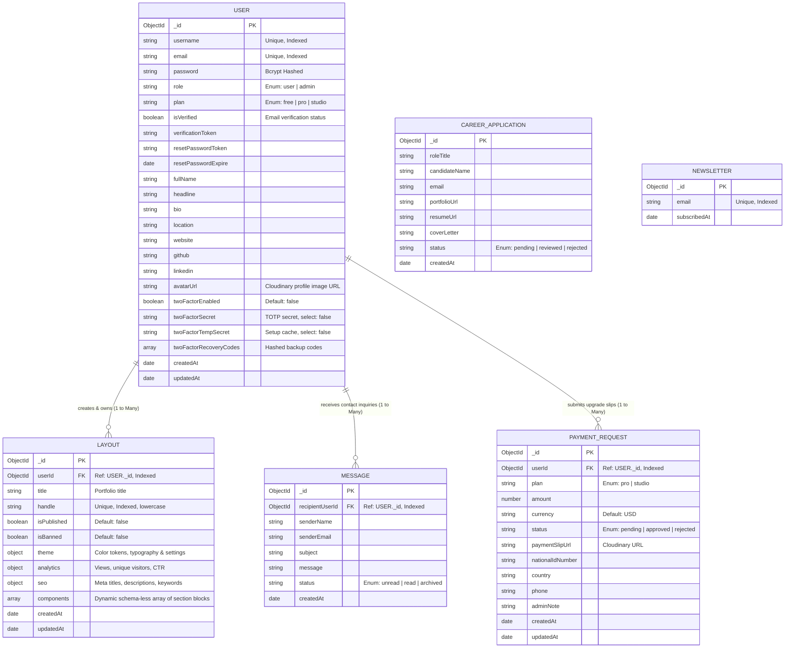

# Database Design & Entity-Relationship Architecture

**Course:** EC4307 Web Application Development Mini Project  
**Author:** Ranaweerage Shashika Madhusankha Priyanath  
**Evaluation Rubric Alignment:** Database Design - Structure, keys, relationships, data types (4 Marks)  

---

## 1. Database Architecture Overview

PortfolioCraft utilizes **MongoDB**, a distributed document-oriented database, managed through the **Mongoose Object Data Modeling (ODM)** library in Node.js. 

### Why MongoDB for PortfolioCraft?
Unlike relational databases that enforce rigid tabular schemas, MongoDB's document model allows **polymorphic, flexible JSON layout storage**. Every user portfolio can possess a completely unique combination and ordering of components (e.g. User A has `[Hero, Projects, Contact]`; User B has `[Hero, About, Timeline, Skills, Markdown, Embed, Contact]`), making document-based storage the optimal architectural choice.

---

## 2. Entity-Relationship Diagram (ERD)

---

## 3. Data Dictionary & Collection Schemas

### 3.1. `users` Collection Schema
*File: `backend/models/User.js`*

| Field | Data Type | Constraints / Attributes | Description |
| :--- | :--- | :--- | :--- |
| `_id` | `ObjectId` | Primary Key, Auto-generated | Unique identifier for user account |
| `username` | `String` | Required, Unique, Trimmed, Min: 3 | Unique login and default handle identifier |
| `email` | `String` | Required, Unique, Lowercase, Regex | User's verified email address |
| `password` | `String` | Required, Min: 6, Bcrypt hashed | One-way encrypted password with 10 salt rounds |
| `role` | `String` | Enum: `['user', 'admin']`, Default: `'user'` | Role-based authorization tier |
| `plan` | `String` | Enum: `['free', 'pro', 'studio']`, Default: `'free'` | Subscription tier determining feature gates |
| `isVerified` | `Boolean` | Default: `false` | Email verification status |
| `verificationToken` | `String` | Optional, String | Token for email confirmation link |
| `resetPasswordToken` | `String` | Optional, String | Token for password recovery |
| `resetPasswordExpire` | `Date` | Optional, Date | Timestamp when reset token expires (1 hour) |
| `fullName` | `String` | Optional, Default: `''` | User's full display name |
| `headline` | `String` | Optional, Default: `''` | Professional tagline (e.g. "Senior Full Stack Dev") |
| `bio` | `String` | Optional, Default: `''` | Short personal biography |
| `location` | `String` | Optional, Default: `''` | City, Country or Remote status |
| `github` | `String` | Optional, Default: `''` | GitHub profile URL |
| `linkedin` | `String` | Optional, Default: `''` | LinkedIn profile URL |
| `avatarUrl` | `String` | Optional, Default: `''` | Cloudinary CDN URL for user profile picture |
| `twoFactorEnabled` | `Boolean` | Default: `false` | Status indicator for RFC 6238 TOTP authentication |
| `twoFactorSecret` | `String` | Optional, `select: false` | Base32 TOTP secret key (hidden from standard queries) |
| `twoFactorTempSecret` | `String` | Optional, `select: false` | Temporary cache key during 2FA setup flow |
| `twoFactorRecoveryCodes` | `Array` | Optional, `select: false` | Array of hashed backup recovery codes |
| `createdAt` | `Date` | Timestamp, Auto-generated | Account creation date |
| `updatedAt` | `Date` | Timestamp, Auto-generated | Last account modification timestamp |

---

### 3.2. `layouts` Collection Schema (Main Portfolio Entity)
*File: `backend/models/Layout.js`*

| Field | Data Type | Constraints / Attributes | Description |
| :--- | :--- | :--- | :--- |
| `_id` | `ObjectId` | Primary Key, Auto-generated | Unique layout ID |
| `userId` | `ObjectId` | Required, Foreign Key (`User._id`), Indexed | References the creator who owns the layout |
| `title` | `String` | Required, Trimmed | Portfolio display title (e.g. "Alex's Portfolio") |
| `handle` | `String` | Required, Unique, Lowercase, Indexed | Slug used for public URL (e.g. `/p/:handle`) |
| `isPublished` | `Boolean` | Default: `false`, Indexed | Visibility switch (Draft mode vs Live site) |
| `isBanned` | `Boolean` | Default: `false` | Administrative moderation override flag |
| `theme` | `Object` | Embedded Subdocument | Contains CSS color variables and typography settings |
| `theme.primaryColor` | `String` | Default: `'#6366f1'` | Buttons, active badges & highlights |
| `theme.secondaryColor` | `String` | Default: `'#a855f7'` | Gradients & subtle glows |
| `theme.backgroundColor` | `String` | Default: `'#070a10'` | Main canvas background color |
| `theme.surfaceColor` | `String` | Default: `'#111827'` | Card and container surface color |
| `theme.textColor` | `String` | Default: `'#f8fafc'` | Heading and primary text color |
| `theme.textMutedColor` | `String` | Default: `'#94a3b8'` | Paragraph and label text color |
| `theme.fontFamily` | `String` | Default: `'Inter'` | Primary Google Font family |
| `theme.templateId` | `String` | Default: `'minimalist-editorial'` | Underlying template ID |
| `theme.hideBranding` | `Boolean` | Default: `false` | Studio feature: hides platform branding |
| `theme.showResumeDownload` | `Boolean` | Default: `true` | Controls visibility of the ATS Resume download button |
| `analytics` | `Object` | Embedded Subdocument | Creator telemetry and performance metrics |
| `analytics.views` | `Number` | Default: `0` | Cumulative page load counter |
| `analytics.uniqueVisitors` | `Number` | Default: `0` | Cumulative unique visitor counter |
| `analytics.resumeDownloads` | `Number` | Default: `0` | Cumulative ATS Resume PDF downloads |
| `analytics.dailyViews` | `Array` | Subdocument Array of `{ date, views, unique, downloads }` | 30-day view velocity history |
| `analytics.referrers` | `Array` | Subdocument Array of `{ source, count }` | Traffic sources (LinkedIn, GitHub, Google, Direct) |
| `seo` | `Object` | Embedded Subdocument | `{ metaTitle, metaDescription, keywords }` |
| `components` | `Array` | Polymorphic Dynamic Array of Components | Section objects: `{ id, type, title, order, isVisible, props }` |

#### Supported Component Types (`components.type` Enum):
`HeroBanner`, `AboutMe`, `ProjectsGrid`, `ExperienceTimeline`, `SkillsCloud`, `TestimonialsCarousel`, `MediaGallery`, `RichTextSection`, `PremiumEmbed`, `AdvancedMetrics`, `CustomHTML`.

---

### 3.3. `messages` Collection Schema
*File: `backend/models/Message.js`*

| Field | Data Type | Constraints / Attributes | Description |
| :--- | :--- | :--- | :--- |
| `_id` | `ObjectId` | Primary Key, Auto-generated | Unique message identifier |
| `recipientUserId` | `ObjectId` | Required, Foreign Key (`User._id`), Indexed | Portfolio creator receiving the inquiry |
| `senderName` | `String` | Required, Trimmed | Inquirer's full name |
| `senderEmail` | `String` | Required, Email regex | Inquirer's reply-to email address |
| `subject` | `String` | Optional, Default: `'Portfolio Inquiry'` | Message subject line |
| `message` | `String` | Required, Max: 5000 chars | Body content of the contact inquiry |
| `status` | `String` | Enum: `['unread', 'read', 'archived']`, Default: `'unread'` | Message lifecycle state |
| `createdAt` | `Date` | Timestamp, Auto-generated | Submission timestamp |

---

### 3.4. `paymentrequests` Collection Schema
*File: `backend/models/PaymentRequest.js`*

| Field | Data Type | Constraints / Attributes | Description |
| :--- | :--- | :--- | :--- |
| `_id` | `ObjectId` | Primary Key, Auto-generated | Payment record ID |
| `userId` | `ObjectId` | Required, Foreign Key (`User._id`), Indexed | User requesting upgrade |
| `plan` | `String` | Required, Enum: `['pro', 'studio']` | Target subscription plan |
| `amount` | `Number` | Required | Transaction amount ($12 or $29) |
| `currency` | `String` | Default: `'USD'` | Currency code |
| `status` | `String` | Enum: `['pending', 'approved', 'rejected']`, Default: `'pending'` | Verification workflow state |
| `paymentSlipUrl` | `String` | Required | Cloudinary CDN receipt image URL |
| `nationalIdNumber` | `String` | Optional, Trimmed | National ID verification number |
| `country` | `String` | Optional | Candidate's residency country |
| `phone` | `String` | Optional | Contact phone number |
| `adminNote` | `String` | Optional | Internal verification note or rejection reason |
| `createdAt` | `Date` | Timestamp, Auto-generated | Upload timestamp |

---

## 4. Indexing & Query Optimization Strategy

To ensure sub-second response times across high-traffic portfolio handles, the database uses strategic indexing:

1. **`users.email` (Unique):** Accelerates login credential lookup to $O(1)$ and guarantees zero email duplication.
2. **`users.username` (Unique):** Fast lookup during registration.
3. **`layouts.handle` (Unique):** Indexed for near-instant resolution when public visitors access `/p/:handle`.
4. **`layouts.userId` (Compound/Secondary):** Fast retrieval of all portfolios owned by an authenticated creator when mounting `/editor`.
5. **`messages.recipientUserId` (Secondary):** Enables rapid indexing for creator inboxes without table scans.
